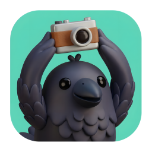
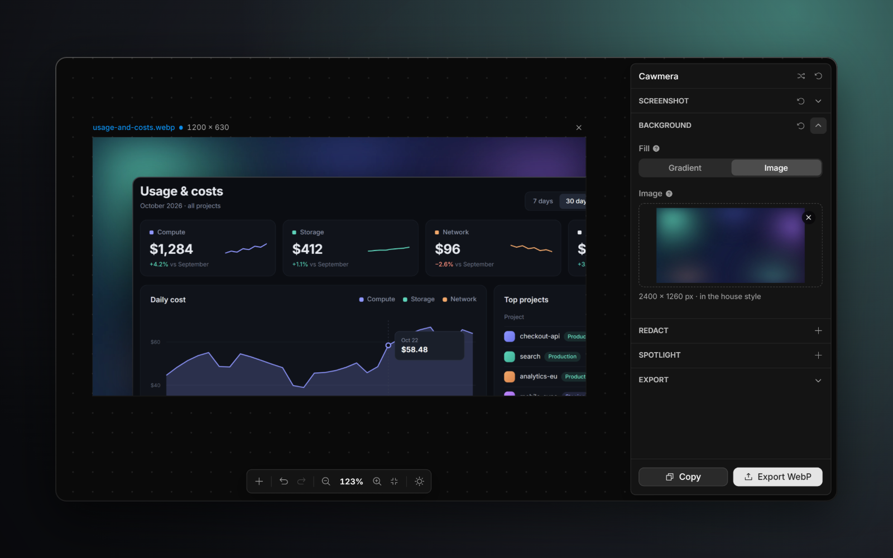

<div align="center">



# Cawmera

**Puts a screenshot into a frame.**<br>
Every image gets the same background and shows the UI at the same scale, at 1600 × 1000 or any size you pick.

[](https://github.com/mateuszbartosik/cawmera/releases/latest)
[](LICENSE)

</div>

<br>

<p align="center">
  
</p>
<p align="center"><sub>Cawmera, framed by Cawmera.</sub></p>

## What it does

- **One scale for the UI.** Cawmera never shrinks a screenshot to fit. Its scale comes from how it was captured, so text reads the same in every image.
- **One look for a product.** Background, light, frame and shadow come from a house style that a team shares as a single file.
- **Any size.** 1600 × 1000 by default, Article (OG) for link previews, presets for slides and social posts, or your own width and height.
- **Private.** Screenshots and recordings stay on your computer, and Cawmera makes no network requests. It never persists them unless you save a draft.

## Download

Get the Windows zip from the [latest release](https://github.com/mateuszbartosik/cawmera/releases/latest), unzip it and run `Cawmera.exe`. The app isn't code-signed, so Windows may warn the first time you open it. Recording needs Windows 10 version 2004 or newer. For macOS or Linux, [build it from source](#develop).

## Use

1. **Add a screenshot**: paste, drop, open, or **Capture** a window or screen, with an optional delay. Or open a [draft](#drafts) to pick up where you left off.
2. **Size**: pick a preset in Export, like **Article (OG)** for 1200 × 630, or type a width and height. The screenshot keeps its scale, so a smaller image shows less of it.
3. **Crop** (`C`) to choose what shows, and pick the **Edge** it comes in from.
4. **Captured at** should match your screen's scaling. A smaller **UI zoom** shows more of the screenshot.
5. **Background**: drag the light around the pad and change its colour or intensity, or set **Fill** to **Image** to put the house background image behind the screenshot.
6. **Shuffle** (`R`) for a new edge and light direction. The part of the screenshot that shows stays.
7. **Redact** private details with blur boxes. **Spotlight** dims everything but one area.
8. **Export** (`Ctrl+S`), **Export all** or **Copy**, as lossless WebP or PNG.

Shots sit side by side on the canvas. `Shift`- or `Ctrl`-click them, or drag a box on empty canvas, to select several; `Delete` removes them and Undo brings them back.

## Record

**Record** a window or screen and Cawmera turns it into an MP4 with the same framing as a screenshot. A countdown of at least 3 seconds comes first, longer if your capture delay is. Cawmera zooms in on your clicks, redraws the cursor smoothly, adds click effects and motion blur, and trims the quiet ends. Check the result in the preview, edit it on the timeline, then export.

Press `Ctrl+Shift+2` to stop, or click Cawmera on the taskbar. Clicking it during the countdown cancels the recording. If you close Cawmera while recording, it stops and keeps the take. Recordings live in your temp folder and are cleared when Cawmera quits, so export what you want to keep, or save a draft. Export is MP4 without sound.

### Edit a recording

- **Timeline.** `Space` plays and pauses. Zoom and scroll the timeline to edit closely, and drag the trim handles to change where the video starts and ends.
- **Clip row.** **Split** (`S`) cuts a clip at the playhead. Select a range and press `Delete` to cut it out. **Speed** runs a range from 1× to 8×, and **Restore** brings a cut back.
- **Zooms.** Select a zoom to move or stretch it, add one, or delete it. In the Zoom section, **Depth** sets how close it gets and **Aim** where it looks. You can also drag the zoom area on the shot. **Back to automatic zooms** drops your edits.
- **Crop** (`C`) works on recordings too.
- **Blur boxes.** Redact private details for as long as you need: add a box with **+** in **Redact**, or `Alt` + drag on the recording. Move and stretch it on the **Blur** row.
- **Motion.** **Cursor blur**, **Camera blur** and **Zoom speed** set how the motion feels.

Recording limits: monitors wider than 4096 px may fail to record, because of H.264 encoder limits. Windows N editions need the Media Feature Pack.

## Drafts

A draft is a `.cawmera` file that keeps your shots and recordings with their edits, so you can come back later. **Save draft** (`Ctrl+Shift+D`, the toolbar button, or when you close Cawmera with unsaved work) writes one. Open it with **Open draft…** in the File menu, with **Open image…** (`Ctrl+O`), whose picker also takes drafts, or by dropping it onto Cawmera. Nothing is kept unless you save a draft.

## House styles

The background, light, frame and scale come from a house style, and so does the background image that **Fill: Image** uses. Open it with `Ctrl+Alt+H`, adjust it, give it a name and **Export style**. Others load the `.json` with **Import style**, or by dropping it onto Cawmera.

## Shortcuts

<details>
<summary>Show all shortcuts</summary>

| Action | Keys |
| --- | --- |
| Open images or a draft | `Ctrl+O` |
| Save draft | `Ctrl+Shift+D` |
| Capture | `Ctrl+Shift+2` |
| Stop recording | `Ctrl+Shift+2` or click Cawmera on the taskbar |
| New shot / next / previous | `Ctrl+N` / `Ctrl+PageDown` / `Ctrl+PageUp` |
| Crop on / off | `C` or double-click the shot (`Enter` or `Esc` to finish) |
| Shuffle the edge and light | `R` |
| Draw a blur box | `Alt` + drag |
| Play / pause a recording | tap `Space` |
| Split a recording at the playhead | `S` |
| Select several shots or boxes | `Shift`/`Ctrl` + click, drag on empty canvas (shots), `Ctrl+A` |
| Delete / nudge what's selected | `Delete` / arrow keys for boxes (`Shift` for 10 px); on a recording, `Delete` cuts a range or removes a zoom |
| Undo / redo (per shot) | `Ctrl+Z` / `Ctrl+Shift+Z` |
| Export / export all / copy | `Ctrl+S` / `Ctrl+Shift+S` / `Ctrl+Shift+C` |
| Zoom in / out / 100% | `Ctrl+=` / `Ctrl+-` / `Ctrl+0` |
| Fit all shots / fit this shot | `Shift+1` / `Shift+2` |
| Pan the canvas | drag inside a shot, hold `Space` and drag, or scroll |
| Light / dark | `Ctrl+Shift+L` |
| House style | `Ctrl+Alt+H` |

</details>

## Develop

```bash
npm install
npm run dev          # run with hot reload
npm test             # unit tests
npm run build:recorder  # the recording helper, Windows only
npm run dist:win     # Windows .exe and zip in release/
npm run build:web    # the same UI as a single HTML file
```

`npm run build:recorder` needs Visual Studio Build Tools with the C++ workload and Windows SDK 10.0.20348 or newer. `npm run dist:win` runs it first.

## License

MIT, see [LICENSE](LICENSE). The MP4 muxer, [mediabunny](https://mediabunny.dev), is bundled under MPL-2.0.
